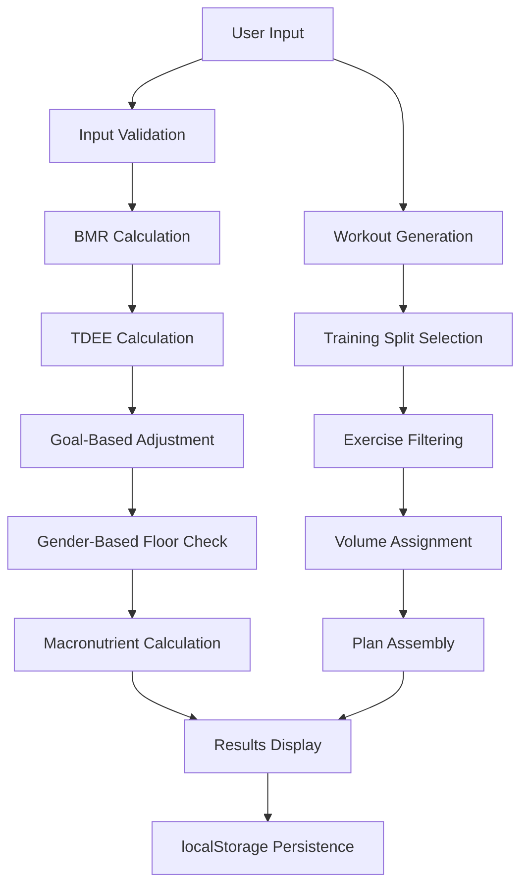

# Design Document: FitPlan Fitness Web App

## Overview

FitPlan is a client-side single-page fitness web application built with React, Vite, and Tailwind CSS. The application provides personalized daily diet targets and weekly workout plans without requiring a backend server. All calculations execute in the browser using scientifically-based formulas, and results persist in localStorage for offline access.

The system consists of three primary computational subsystems:
1. **Diet Calculator** - Computes BMR, TDEE, and macronutrient targets using Mifflin-St Jeor equations
2. **Workout Generator** - Creates weekly training plans based on user goals, experience, and equipment availability
3. **Results Display** - Visualizes nutrition and workout plans with interactive charts and exportable formats

The application architecture emphasizes:
- **Client-side execution** - All logic runs in the browser without server dependencies
- **Data persistence** - Results saved to localStorage for session continuity
- **Responsive design** - Mobile-first approach with dark theme and single accent color
- **Scientific accuracy** - Validated formulas for BMR, TDEE, and macronutrient calculations

## Architecture

### System Components

The application follows a modular React component architecture with clear separation of concerns:

```
FitPlan App
├── Layout Components
│   ├── Hero Section
│   ├── Features Section
│   ├── How It Works Section
│   ├── Pricing Section
│   ├── Reviews Section
│   ├── FAQ Section
│   └── Footer Section
├── Calculator Component
│   ├── Input Form
│   └── Validation Logic
├── Computation Engine
│   ├── Diet Calculator
│   │   ├── BMR Calculator
│   │   ├── TDEE Calculator
│   │   ├── Goal Adjuster
│   │   └── Macronutrient Calculator
│   └── Workout Generator
│       ├── Training Split Selector
│       ├── Exercise Database
│       ├── Volume Calculator
│       └── Plan Builder
└── Results Component
    ├── Diet Results Display
    │   ├── Macronutrient Chart
    │   └── Daily Targets Card
    ├── Workout Results Display
    │   └── Weekly Plan Cards
    ├── Tab Navigation
    └── Export Handler
```

### Data Flow

1. **Input Collection**: Calculator component gathers user data (gender, age, weight, height, activity level, goal, training location, days, experience)
2. **Validation**: Input validator checks ranges and required fields before processing
3. **Computation**: 
   - Diet Calculator computes BMR → TDEE → Goal-Adjusted Calories → Macronutrients
   - Workout Generator selects training split → filters exercises → assigns volume → builds weekly plan
4. **Persistence**: Complete results object serialized to localStorage
5. **Display**: Results component renders diet and workout data with visualizations
6. **Restoration**: On page load, check localStorage and restore previous results if available

### Technology Stack

- **Framework**: React 18+ with functional components and hooks
- **Build Tool**: Vite for fast development and optimized production builds
- **Styling**: Tailwind CSS for utility-first responsive design
- **Charting**: Lightweight charting library (Recharts or Chart.js) for donut chart visualization
- **Storage**: Browser localStorage API for client-side persistence
- **Export**: Browser print API or PDF generation library (jsPDF or react-to-print)

### Calculation Pipeline

The calculation flow follows a dependency chain:



## Components and Interfaces

### Calculator Component

**Purpose**: Collects user fitness data and validates inputs before computation.

**Props**: 
- `onSubmit: (data: UserInput) => void` - Callback when valid form submitted
- `initialValues?: Partial<UserInput>` - Optional pre-filled values

**State**:
```typescript
interface CalculatorState {
  gender: 'male' | 'female';
  age: number;
  weight: number; // kg
  height: number; // cm
  activityLevel: 'low' | 'medium' | 'high';
  goal: 'gain_weight' | 'stay_lean' | 'lose_weight';
  trainingLocation: 'home' | 'gym';
  trainingDays: 3 | 4 | 5 | 6;
  experienceLevel: 'beginner' | 'intermediate' | 'advanced';
  errors: Partial<Record<keyof Omit<CalculatorState, 'errors'>, string>>;
}
```

**Validation Rules**:
- Age: 10-100 inclusive
- Weight: 30-300 kg inclusive
- Height: 100-250 cm inclusive
- All fields required
- Numeric fields must parse to valid numbers

### Diet Calculator Module

**Purpose**: Computes daily calorie and macronutrient targets using scientific formulas.

**Interface**:
```typescript
interface DietInput {
  gender: 'male' | 'female';
  age: number;
  weight: number; // kg
  height: number; // cm
  activityLevel: 'low' | 'medium' | 'high';
  goal: 'gain_weight' | 'stay_lean' | 'lose_weight';
}

interface DietResults {
  bmr: number;
  tdee: number;
  dailyCalories: number;
  protein: number; // grams
  carbs: number; // grams
  fat: number; // grams
  fiber: number; // grams
}

function calculateDiet(input: DietInput): DietResults;
```

**Calculation Steps**:

1. **BMR Calculation** (Mifflin-St Jeor Equation):
   - Male: `BMR = 10 × weight + 6.25 × height - 5 × age + 5`
   - Female: `BMR = 10 × weight + 6.25 × height - 5 × age - 161`

2. **TDEE Calculation**:
   - Low activity: `TDEE = BMR × 1.375`
   - Medium activity: `TDEE = BMR × 1.55`
   - High activity: `TDEE = BMR × 1.725`

3. **Goal-Based Adjustment**:
   - Gain weight: `calories = TDEE + 400`
   - Stay lean: `calories = TDEE`
   - Lose weight: `calories = TDEE - 500`

4. **Gender-Based Floor**:
   - Male: `calories = max(calories, 1500)`
   - Female: `calories = max(calories, 1200)`

5. **Macronutrient Calculation**:
   - Protein: `2.0 g/kg body weight`
   - Protein calories: `protein_grams × 4`
   - Fat: `(calories × 0.25) / 9` grams
   - Fat calories: `fat_grams × 9`
   - Carbs: `(calories - protein_calories - fat_calories) / 4` grams
   - Fiber: `(calories / 1000) × 14` grams

### Workout Generator Module

**Purpose**: Creates weekly training plans based on user constraints and goals.

**Interface**:
```typescript
interface WorkoutInput {
  trainingDays: 3 | 4 | 5 | 6;
  trainingLocation: 'home' | 'gym';
  experienceLevel: 'beginner' | 'intermediate' | 'advanced';
  goal: 'gain_weight' | 'stay_lean' | 'lose_weight';
}

interface Exercise {
  name: string;
  category: 'push' | 'pull' | 'legs' | 'core' | 'cardio' | 'upper' | 'lower' | 'full_body';
  location: 'home' | 'gym' | 'both';
  equipment: string[];
}

interface WorkoutDay {
  day: string; // "Day 1", "Day 2", etc.
  focus: string; // "Push", "Pull", "Legs", "Upper", "Lower", "Full Body", "Rest"
  exercises: {
    name: string;
    sets: string; // "3-4", "4-5"
    reps: string; // "6-10", "10-15"
    rest: string; // "90-120s", "60s"
  }[];
}

interface WorkoutPlan {
  weeklyPlan: WorkoutDay[];
  totalTrainingDays: number;
}

function generateWorkout(input: WorkoutInput): WorkoutPlan;
```

**Training Split Logic**:
- 3 days: Full Body × 3
- 4 days: Upper, Lower, Upper, Lower
- 5 days: Push, Pull, Legs, Upper, Lower
- 6 days: Push, Pull, Legs, Push, Pull, Legs

**Exercise Database Structure**:
```typescript
// exercises.ts or exercises.json
const exerciseDatabase: Exercise[] = [
  {
    name: "Barbell Bench Press",
    category: "push",
    location: "gym",
    equipment: ["barbell", "bench"]
  },
  {
    name: "Push-ups",
    category: "push",
    location: "both",
    equipment: ["bodyweight"]
  },
  // ... more exercises
];
```

**Volume Assignment**:
- Beginner: 2-3 sets per exercise
- Intermediate: 3-4 sets per exercise
- Advanced: 4-5 sets per exercise

**Goal-Based Programming**:
- Gain weight: 6-10 reps, 90-120s rest, minimal cardio
- Stay lean: 8-12 reps, 60-90s rest, 1-2 cardio sessions
- Lose weight: 10-15 reps, 60s rest, frequent cardio

### Results Display Component

**Purpose**: Visualizes diet and workout plans with interactive navigation and export capabilities.

**Props**:
```typescript
interface ResultsProps {
  dietResults: DietResults;
  workoutPlan: WorkoutPlan;
  onExport: () => void;
}
```

**Features**:
- Tab navigation between diet and workout views
- Donut chart showing macronutrient percentage breakdown
- Card-based layout for diet targets and workout days
- Export button triggering print/PDF generation
- Medical disclaimer display

### Storage Handler

**Purpose**: Persists and retrieves calculation results from localStorage.

**Interface**:
```typescript
interface StoredResults {
  timestamp: number;
  userInput: UserInput;
  dietResults: DietResults;
  workoutPlan: WorkoutPlan;
}

function saveResults(results: StoredResults): void;
function loadResults(): StoredResults | null;
function clearResults(): void;
```

**Storage Key**: `fitplan_results`

## Data Models

### User Input Model
```typescript
interface UserInput {
  gender: 'male' | 'female';
  age: number; // years, range: 10-100
  weight: number; // kg, range: 30-300
  height: number; // cm, range: 100-250
  activityLevel: 'low' | 'medium' | 'high';
  goal: 'gain_weight' | 'stay_lean' | 'lose_weight';
  trainingLocation: 'home' | 'gym';
  trainingDays: 3 | 4 | 5 | 6;
  experienceLevel: 'beginner' | 'intermediate' | 'advanced';
}
```

### Diet Results Model
```typescript
interface DietResults {
  bmr: number; // Basal Metabolic Rate in calories
  tdee: number; // Total Daily Energy Expenditure in calories
  dailyCalories: number; // Goal-adjusted daily calorie target
  protein: number; // grams per day
  carbs: number; // grams per day
  fat: number; // grams per day
  fiber: number; // grams per day
}
```

### Workout Plan Model
```typescript
interface WorkoutPlan {
  weeklyPlan: WorkoutDay[];
  totalTrainingDays: number;
}

interface WorkoutDay {
  day: string; // "Day 1", "Day 2", etc.
  focus: string; // Training focus (Push, Pull, Legs, etc.)
  exercises: ExerciseDetail[];
}

interface ExerciseDetail {
  name: string;
  sets: string; // e.g., "3-4"
  reps: string; // e.g., "6-10"
  rest: string; // e.g., "90-120s"
}
```

### Exercise Database Model
```typescript
interface Exercise {
  name: string;
  category: 'push' | 'pull' | 'legs' | 'core' | 'cardio' | 'upper' | 'lower' | 'full_body';
  location: 'home' | 'gym' | 'both';
  equipment: string[]; // e.g., ["barbell", "bench"]
}
```

### Validation Error Model
```typescript
interface ValidationErrors {
  age?: string;
  weight?: string;
  height?: string;
  general?: string; // For missing required fields
}
```


## Correctness Properties

*A property is a characteristic or behavior that should hold true across all valid executions of a system—essentially, a formal statement about what the system should do. Properties serve as the bridge between human-readable specifications and machine-verifiable correctness guarantees.*

### Property 1: Input validation rejects invalid age ranges

*For any* age value outside the range [10, 100], the validation system SHALL reject the input and display an appropriate error message.

**Validates: Requirements 6.2**

### Property 2: Input validation rejects invalid weight ranges

*For any* weight value outside the range [30, 300] kg, the validation system SHALL reject the input and display an appropriate error message.

**Validates: Requirements 6.3**

### Property 3: Input validation rejects invalid height ranges

*For any* height value outside the range [100, 250] cm, the validation system SHALL reject the input and display an appropriate error message.

**Validates: Requirements 6.4**

### Property 4: Input validation rejects non-numeric values

*For any* non-numeric string input in numeric fields (age, weight, height), the validation system SHALL reject the input and display an appropriate error message.

**Validates: Requirements 6.5**

### Property 5: Input validation accepts valid inputs

*For any* user input where gender is in {male, female}, age is in [10, 100], weight is in [30, 300], height is in [100, 250], activityLevel is in {low, medium, high}, goal is in {gain_weight, stay_lean, lose_weight}, trainingLocation is in {home, gym}, trainingDays is in {3, 4, 5, 6}, and experienceLevel is in {beginner, intermediate, advanced}, the validation system SHALL accept the input and enable form submission.

**Validates: Requirements 6.6**

### Property 6: BMR calculation for males follows Mifflin-St Jeor equation

*For any* valid male user with weight w (kg), height h (cm), and age a (years), the BMR calculation SHALL produce the result: BMR = 10 × w + 6.25 × h - 5 × a + 5.

**Validates: Requirements 7.1**

### Property 7: BMR calculation for females follows Mifflin-St Jeor equation

*For any* valid female user with weight w (kg), height h (cm), and age a (years), the BMR calculation SHALL produce the result: BMR = 10 × w + 6.25 × h - 5 × a - 161.

**Validates: Requirements 7.2**

### Property 8: TDEE calculation applies correct activity multiplier

*For any* valid BMR value and activity level, the TDEE calculation SHALL apply the correct multiplier: 1.375 for low activity, 1.55 for medium activity, or 1.725 for high activity.

**Validates: Requirements 8.1, 8.2, 8.3**

### Property 9: Goal-based calorie adjustment applies correct offset

*For any* valid TDEE value and goal, the calorie adjustment SHALL apply the correct offset: +400 for gain_weight, +0 for stay_lean, or -500 for lose_weight (before applying gender-based floor).

**Validates: Requirements 9.1, 9.2, 9.3**

### Property 10: Gender-based calorie floor is enforced

*For any* male user, if the goal-adjusted calories fall below 1500, the daily calorie target SHALL be set to 1500. For any female user, if the goal-adjusted calories fall below 1200, the daily calorie target SHALL be set to 1200.

**Validates: Requirements 9.4, 9.5**

### Property 11: Protein calculation follows 2.0 g/kg formula

*For any* valid weight w (kg), the daily protein target SHALL be calculated as 2.0 × w grams.

**Validates: Requirements 10.1**

### Property 12: Fat calculation follows 25% calorie allocation

*For any* valid daily calorie target c, the daily fat target SHALL be calculated as (c × 0.25) / 9 grams.

**Validates: Requirements 10.2**

### Property 13: Carbohydrate calculation fills remaining calories

*For any* valid daily calorie target c, protein calories p_cal (protein_grams × 4), and fat calories f_cal (fat_grams × 9), the daily carbohydrate target SHALL be calculated as (c - p_cal - f_cal) / 4 grams.

**Validates: Requirements 10.3**

### Property 14: Fiber calculation follows 14g per 1000 calories formula

*For any* valid daily calorie target c, the daily fiber target SHALL be calculated as (c / 1000) × 14 grams.

**Validates: Requirements 10.4**

### Property 15: Macronutrient calorie balance invariant

*For any* valid diet calculation result, the sum of protein calories (protein × 4) plus carbohydrate calories (carbs × 4) plus fat calories (fat × 9) SHALL equal the daily calorie target within a tolerance of 10 calories.

**Validates: Requirements 10.5**

### Property 16: Exercise selection respects location constraints

*For any* workout plan generated with trainingLocation set to 'home', all selected exercises SHALL have location property equal to 'home' or 'both'. For any workout plan generated with trainingLocation set to 'gym', all selected exercises SHALL have location property equal to 'gym' or 'both'.

**Validates: Requirements 13.1, 13.2**

### Property 17: Goal-based workout programming applies correct parameters

*For any* workout plan generated with goal='gain_weight', all resistance exercises SHALL have rep ranges between 6-10, rest periods between 90-120 seconds, and cardio sessions SHALL be minimal or absent. For any workout plan with goal='lose_weight', all resistance exercises SHALL have rep ranges between 10-15, rest periods around 60 seconds, and cardio sessions SHALL be frequent.

**Validates: Requirements 14.1, 14.3**

### Property 18: Experience-based volume assignment is correct

*For any* workout plan generated with experienceLevel='beginner', all exercises SHALL have 2-3 sets. For any workout plan with experienceLevel='intermediate', all exercises SHALL have 3-4 sets. For any workout plan with experienceLevel='advanced', all exercises SHALL have 4-5 sets.

**Validates: Requirements 15.1, 15.2, 15.3**

### Property 19: Results persistence round-trip preserves data

*For any* valid calculation result (diet and workout data), saving the result to localStorage and then loading it SHALL produce data equivalent to the original result.

**Validates: Requirements 18.1, 18.2**

## Error Handling

### Input Validation Errors

**Strategy**: Validate all user inputs before computation and provide clear, actionable error messages.

**Error Scenarios**:
1. **Missing Required Fields**: Display message identifying which fields are empty
2. **Out of Range Values**: Display specific range constraints (e.g., "Age must be between 10 and 100")
3. **Type Errors**: Display message requesting numeric input for numeric fields
4. **Format Errors**: Handle unexpected input formats gracefully

**Implementation**:
- Client-side validation before form submission
- Field-level validation with immediate feedback
- Summary error message if multiple fields are invalid
- Error state management in form component

### Calculation Errors

**Strategy**: Handle edge cases in mathematical computations to prevent runtime errors.

**Error Scenarios**:
1. **Division by Zero**: Should not occur with validated inputs, but guard against null/undefined values
2. **Floating Point Precision**: Round final values to appropriate precision (calories to nearest integer, macros to 1 decimal place)
3. **Negative Values**: Apply floor constraints to prevent negative calorie/macro targets

**Implementation**:
- Defensive checks in calculation functions
- Rounding utilities for consistent precision
- Floor/ceiling constraints for realistic ranges

### Storage Errors

**Strategy**: Handle localStorage availability and quota issues gracefully.

**Error Scenarios**:
1. **localStorage Unavailable**: Gracefully degrade if localStorage is disabled or unavailable (private browsing)
2. **Quota Exceeded**: Unlikely with small data, but handle quota errors
3. **Corrupted Data**: Validate loaded data structure before use

**Implementation**:
```typescript
function saveResults(results: StoredResults): boolean {
  try {
    localStorage.setItem('fitplan_results', JSON.stringify(results));
    return true;
  } catch (e) {
    console.error('Failed to save results:', e);
    // Optionally notify user
    return false;
  }
}

function loadResults(): StoredResults | null {
  try {
    const data = localStorage.getItem('fitplan_results');
    if (!data) return null;
    
    const parsed = JSON.parse(data);
    // Validate structure
    if (!isValidStoredResults(parsed)) {
      console.warn('Invalid stored results structure');
      return null;
    }
    return parsed;
  } catch (e) {
    console.error('Failed to load results:', e);
    return null;
  }
}
```

### Export Errors

**Strategy**: Handle browser API failures gracefully.

**Error Scenarios**:
1. **Print API Unavailable**: Rare, but handle if window.print is not available
2. **PDF Generation Failure**: If using PDF library, handle generation errors

**Implementation**:
- Try-catch around browser API calls
- Fallback message if export fails
- User notification of export status

### Workout Generation Errors

**Strategy**: Ensure exercise database has sufficient exercises for all configurations.

**Error Scenarios**:
1. **Insufficient Exercises**: Not enough exercises for a given location/split combination
2. **Invalid Exercise Data**: Malformed exercise database entries

**Implementation**:
- Validate exercise database on load
- Ensure minimum exercise counts for each category
- Fallback to broader category if specific exercises unavailable

## Testing Strategy

### Overview

The FitPlan application requires a dual testing approach combining property-based testing for calculation logic and example-based testing for UI components and integrations.

**Testing Philosophy**:
- **Property-based tests** verify universal correctness properties across many randomized inputs (calculations, validation, data transformations)
- **Unit tests** verify specific examples, edge cases, and component behavior
- **Integration tests** verify end-to-end workflows and UI interactions

### Property-Based Testing

**Framework**: Use `fast-check` library for JavaScript/TypeScript property-based testing.

**Configuration**: Each property test MUST run a minimum of 100 iterations to ensure comprehensive coverage across the input space.

**Test Organization**: Each correctness property from the design document MUST have a corresponding property-based test tagged with a comment referencing the design property.

**Tag Format**:
```typescript
// Feature: fitplan-fitness-app, Property 6: BMR calculation for males follows Mifflin-St Jeor equation
test('BMR calculation for males', () => {
  fc.assert(
    fc.property(
      fc.integer({ min: 30, max: 300 }), // weight
      fc.integer({ min: 100, max: 250 }), // height
      fc.integer({ min: 10, max: 100 }), // age
      (weight, height, age) => {
        const expected = 10 * weight + 6.25 * height - 5 * age + 5;
        const result = calculateBMR({ gender: 'male', weight, height, age });
        expect(result).toBeCloseTo(expected, 1);
      }
    ),
    { numRuns: 100 }
  );
});
```

**Property Test Suite**:

1. **Input Validation Properties** (Properties 1-5)
   - Test invalid age/weight/height rejection
   - Test non-numeric input rejection
   - Test valid input acceptance

2. **BMR Calculation Properties** (Properties 6-7)
   - Test male and female BMR formulas

3. **TDEE Calculation Properties** (Property 8)
   - Test activity multiplier application

4. **Calorie Adjustment Properties** (Properties 9-10)
   - Test goal-based adjustments
   - Test gender-based floor constraints

5. **Macronutrient Calculation Properties** (Properties 11-15)
   - Test protein, fat, carb, fiber formulas
   - Test calorie balance invariant

6. **Workout Generation Properties** (Properties 16-18)
   - Test exercise location filtering
   - Test goal-based programming parameters
   - Test experience-based volume assignment

7. **Persistence Properties** (Property 19)
   - Test localStorage round-trip preservation

### Unit Testing

**Framework**: Use Vitest or Jest for unit testing React components and utilities.

**Focus Areas**:

1. **Component Rendering**
   - Hero, Features, How It Works, Pricing, Reviews, FAQ, Footer sections render correctly
   - Calculator form renders with all input fields
   - Results display renders diet and workout cards

2. **User Interactions**
   - Button clicks trigger expected actions
   - Form submission with valid/invalid data
   - Tab navigation between diet and workout results
   - FAQ accordion expand/collapse

3. **Training Split Selection** (Examples for each day count)
   - 3 days → Full Body split
   - 4 days → Upper/Lower split
   - 5 days → Push/Pull/Legs/Upper/Lower split
   - 6 days → Push/Pull/Legs × 2 split

4. **Edge Cases**
   - Empty localStorage on initial load
   - Corrupted localStorage data
   - Missing required form fields
   - Boundary values for age/weight/height

### Integration Testing

**Framework**: Use Vitest + Testing Library for integration tests, or Playwright/Cypress for E2E tests.

**Focus Areas**:

1. **End-to-End Workflow**
   - User fills calculator → sees results → results persist → page reload → results restored

2. **Responsive Layout**
   - Test at mobile, tablet, desktop breakpoints
   - Verify layout adapts appropriately

3. **Export Functionality**
   - Verify print API is called correctly
   - Verify exported content includes diet and workout data

4. **Accessibility**
   - Keyboard navigation works for all interactive elements
   - Color contrast meets WCAG standards
   - Screen reader compatibility

### Test Coverage Goals

- **Unit + Integration Tests**: 80% code coverage minimum
- **Property Tests**: 100% coverage of all 19 correctness properties
- **Critical Paths**: 100% coverage of calculation logic (BMR, TDEE, macros, workout generation)

### Continuous Testing

- Run unit tests on every commit (pre-commit hook or CI)
- Run property tests in CI pipeline with 100 iterations
- Manual accessibility testing before major releases

